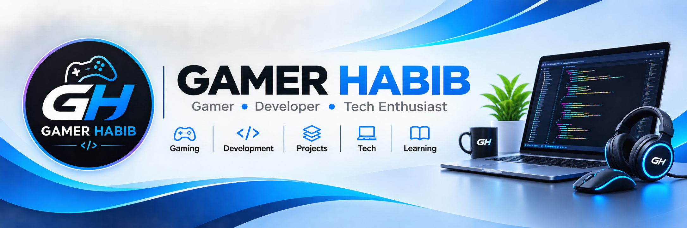

# 🎮 GAMER HABIB
**Gamer • Developer • Tech Enthusiast**

---

### 👋 About Me

I'm Gamer Habib — a technology enthusiast interested in gaming, software development, web technologies and creating useful digital products.

**🎯 Mission:** Learn • Build • Experiment • Create

📍 Bangladesh · 💻 Developer · 🎮 Gamer · 🚀 Tech Enthusiast

---

### 🚀 Featured Projects

<table>
<tr>
<td width="33%" valign="top">

**🎮 Gaming Portfolio**

Personal Gaming & Developer Portfolio.

[Explore →](https://github.com/gamemailhabib-ui/gaming-portfolio)

</td>
<td width="33%" valign="top">

**💻 Web Development**

Web Development Projects & Experiments.

[Explore →](https://github.com/gamemailhabib-ui/web-development)

</td>
<td width="33%" valign="top">

**🐘 PHP Projects**

PHP Development & Learning Workspace.

[Explore →](https://github.com/gamemailhabib-ui/php-projects)

</td>
</tr>
</table>

---

### 🛠️ Technology Stack

---

### 📌 Current Focus

| Area | Focus |
|---|---|
| Development | Web Applications |
| Backend | PHP & Laravel |
| Frontend | JavaScript & React |
| Exploration | Modern Technologies |

---

**💙 THANKS FOR VISITING!**

### GAMER HABIB
*Play • Code • Create*

[GitHub Profile](https://github.com/gamemailhabib-ui)

